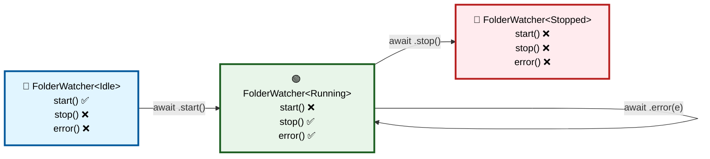

# 🤓 Urkel
**"Did I do that?" — Never ask that about your state transitions again.**

[](https://github.com/mackoj/urkel/actions/workflows/ci.yml)

**[Website](https://mackoj.github.io/urkel/)** ·
**[Language grammar](userstories/grammar.ebnf)** ·
**[Examples](Examples/Showcase)** ·
**[Performance](docs/performance.md)** ·
**[Architecture rules](docs/architecture-rules.md)**

Urkel is a small Domain-Specific Language (DSL) and compiler for generating **compile-time safe** finite state machines in Swift. State machines are written in a human-readable `.urkel` file; an SPM build plugin turns each one into Swift.

Urkel uses the **typestate pattern** and Swift's `~Copyable` (noncopyable) types: every state is a type, every transition is a `consuming` method that exists only on the states that allow it. If an event isn't valid for the current state, your code does not compile.

---

## 🛑 The Problem: Runtime State Chaos
State management in Swift is notoriously tricky, especially when concurrency gets involved. When you use standard enums and booleans to track state, the compiler has no idea what your domain logic actually is.

**The Car Problem:** If you are building a driving simulator, the compiler will happily let you call `car.accelerate()` even if the car's state is currently `EngineOff` or `StoppedAtRedLight`.

To prevent this, you end up writing endless `guard` statements, throwing runtime errors, and trying to track down race conditions.

## ✅ The Solution: Typestate & Isolation
Urkel shifts state validation to the **compiler**. By encoding the state into the type signature itself, Urkel guarantees linear progression, and because states are consumed and passed forward, there is only ever one live value per machine.

### 1. Write your `.urkel` definition
Urkel syntax is simple, readable, and relies on a **Bring Your Own Types (BYOT)** philosophy:

```text
## A checkout flow.
machine Checkout: CheckoutContext

@states
  init  Cart
  state Paying
  final Receipt

@transitions
  # [Current] -> [Event(Payload)]  -> [Next]
  Cart        -> pay(amount: Int)  -> Paying
  Paying      -> succeed           -> Receipt
  Paying      -> fail              -> Cart
```

`machine Checkout: CheckoutContext` threads a context value of your own type through every transition. The full language (guards, actions, `@entry`/`@exit` hooks, `after(30s)` timers, `always`, compound states with `@history`, `@import` sub-machines, `@on` reactions, `@parallel` regions) is specified in [`userstories/grammar.ebnf`](userstories/grammar.ebnf), described in [`Language-Spec.md`](Sources/Urkel/Urkel.docc/Language-Spec.md), and demonstrated by the 24 machines in [`Examples/Showcase`](Examples/Showcase).

### 2. Urkel generates the typestate interface
On every build, the `UrkelPlugin` build-tool plugin compiles each `.urkel` file in the target into three files: the machine, a runtime builder and a [swift-dependencies](https://github.com/pointfreeco/swift-dependencies) client. An excerpt of what it generates for `Checkout.urkel`:

```swift
public enum CheckoutPhase {
    public enum Cart {}
    public enum Paying {}
    public enum Receipt {}
}

public struct CheckoutMachine<Phase>: ~Copyable, Sendable { … }

extension CheckoutMachine where Phase == CheckoutPhase.Cart {
    // You can ONLY call pay(amount:) when the phase is Cart.
    // 'consuming' ends the Cart value: you cannot call it twice.
    public consuming func pay(amount: Int) async throws -> CheckoutMachine<CheckoutPhase.Paying>
}

extension CheckoutMachine where Phase == CheckoutPhase.Paying {
    public consuming func succeed() async throws -> CheckoutMachine<CheckoutPhase.Receipt>
    public consuming func fail() async throws -> CheckoutMachine<CheckoutPhase.Cart>
}
```

Every generated file is parsed back with SwiftParser before it is written, so a syntax error in the output never reaches your build.

### 3. You implement the business logic
Urkel generates the interface and the constraints; you provide the effects as `@Sendable` closures over your context, through `CheckoutClientRuntime`:

```swift
let runtime = CheckoutClientRuntime(
    initialContext: { CheckoutContext() },
    payIntTransition: { context, amount in
        var context = context
        context.charged = amount  // call your payment service here
        return context
    },
    succeedTransition: { context in context },
    failTransition: { context in context }
)
```

and the compiler holds the rest of your code to the machine:

```swift
func checkout(_ cart: consuming CheckoutMachine<CheckoutPhase.Cart>) async throws -> Int {
    let paying = try await cart.pay(amount: 4_200)   // Cart → Paying
    let receipt = try await paying.succeed()         // Paying → Receipt
    return receipt.withContext { $0.charged }        // read without consuming
}

try await cart.succeed()
// error: referencing instance method 'succeed()' on 'CheckoutMachine'
//   requires the types 'CheckoutPhase.Cart' and 'CheckoutPhase.Paying' be equivalent

let again = try await cart.pay(amount: 4_200)
// error: 'cart' consumed more than once
```

### How It All Works Together: The Typestate Pattern

Urkel's magic comes from encoding state in the **type system itself**. Here's how:



**What makes this special:**

| State | Available Methods | Why Others Can't Call Them |
|-------|------------------|---------------------------|
| **Idle** | `start()` | ✅ Type is `FolderWatcher<Idle>` | stop(), error() exist only on `FolderWatcher<Running>`, not `FolderWatcher<Idle>` |
| **Running** | `stop()`, `error()` | ✅ Type is `FolderWatcher<Running>` | The compiler literally won't let you call start() because there's no such method on this type |
| **Stopped** | *(none)* | ✅ Type is `FolderWatcher<Stopped>` | Final state; no transitions available |

**The genius:** When you call `start()`, it **consumes** the `Idle` state and returns a `Running` state. The old state no longer exists. You cannot accidentally call `start()` twice because the first call destroyed the `Idle` instance.

```swift
var watcher = FolderWatcher<Idle>(...)
let running = await watcher.start()    // ✅ OK: Idle → Running

await watcher.stop()                   // ❌ COMPILE ERROR
// error: use of consumed value 'watcher'
// The Idle instance was consumed by start()

await running.stop()                   // ✅ OK: Running → Stopped
let stopped = await running.stop()
```

---

## ✨ Key Features

* **Zero Invalid States:** By encoding states as generic type parameters (`CheckoutMachine<CheckoutPhase.Cart>`), illegal transitions result in Xcode build errors, not runtime crashes.
* **Memory Safety & Linear Progression:** Leverages Swift 5.9+ `~Copyable` and `~Escapable` types. When you transition from `A` to `B`, state `A` is `consuming`. You physically cannot accidentally reuse an old state or create duplicated state branches.
* **Painless Swift 6 Concurrency:** By enforcing strict architectural boundaries and state consumption, Urkel isolates side effects perfectly. It makes complex async workflows completely thread-safe without drowning your codebase in `@Sendable` requirements.
* **Bring Your Own Types (BYOT):** Urkel doesn't force you into a proprietary type system. Pass your existing Swift structs, classes, or actors as transition payloads.
* **Magical Tooling:** Includes an SPM `BuildToolPlugin`. Just drop `.urkel` files into your Xcode project, hit `Cmd + B`, and the code generates automatically in the background.

### Implementation Status Matrix

Not all features are equally mature. Here's what's ready to use now vs. what's coming:

| Feature | Status | Swift Version | Notes |
|---------|--------|---------------|-------|
| **Type-safe FSM with state encoding** | ✅ Stable | 5.9+ | Core feature; all machines use `Machine<State>` |
| **Noncopyable types (~Copyable)** | ✅ Stable | 5.9+ | All generated machines are noncopyable; prevents state duplication |
| **Move semantics (consuming)** | ✅ Stable | 5.9+ | All transitions use `consuming func`; old state is destroyed |
| **@Sendable closures** | ✅ Stable | 5.1+ | All transition closures are `@Sendable`; Swift 6 ready |
| **Typestate Pattern** | ✅ Stable | 5.9+ | Encode state in type parameters; impossible to call wrong transition |
| **Bring Your Own Types (BYOT)** | ✅ Stable | 5.9+ | Use your own domain types; Urkel doesn't force a framework |
| **SPM Build Tool Plugin** | ✅ Stable | 5.9+ | Generates code automatically during `swift build` |
| **Command Plugin (checked-in gen)** | ✅ Stable | 5.9+ | Write generated files directly to repo |
| **`@import` sub-machines + `=> Sub.init` fork** | 🟡 Works | 5.9+ | Sub-machine state is carried through; lifecycle orchestration is limited |
| **`@on Sub::State` reactions** | 🟡 Works | 5.9+ | Emitted on the combined state enum |
| **Mustache Templates** | 🟡 Works | — | Custom Kotlin or bring your own templates |
| **Noncopyable (~Escapable)** | 🟡 Partial | 5.9+ | Context-threaded mode only (not default) |
| **Fork operator & orchestration** | 📋 Planned | TBD | Epic 11; manage lifecycle of multiple sub-FSMs |
| **SE-0432 (noncopyable switch)** | 📋 Prepared | 6.0+ | Design compatible; adoption pending |
| **SE-0430 (transferring)** | 📋 Prepared | 6.0+ | Move semantics prepared; explicit adoption pending |

**Legend:** ✅ = Fully working and stable | 🟡 = Works with limitations | 📋 = Planned, not yet available

---

## 🎯 Why Each Technique Matters

Urkel's power comes from combining several advanced Swift features. Here's why each one is essential:

### ~Copyable (Noncopyable Types)

Normally, Swift structs can be copied. But with Urkel FSMs, there should be only *one* legal state at any time. Making machines `~Copyable` prevents accidental duplication.

```swift
var idle = Machine<Idle>(...)
let running = await idle.start()  // idle is consumed here!
// idle no longer exists; you cannot accidentally call start() again
```

Without noncopyability, you could do:
```swift
var idle = Machine<Idle>(...)
let copy = idle  // ❌ Wrong! Now you have two copies of the same state
```

**Impact:** Eliminates entire classes of concurrency bugs at compile time.

### consuming (Move Semantics)

When you call `consuming func start() -> Machine<Running>`, the Idle machine is **explicitly moved** into the function and destroyed. You cannot reuse it.

```swift
consuming func start() async -> Machine<Running> {
    // old self is consumed and destroyed
    // you must return a new Machine<Running>
}
```

The compiler enforces this. You will get a "consumed" error if you try to use the old state.

**Impact:** Forces linear progression through states. No branching, no duplication.

### @Sendable Closures

Every transition is an `@Sendable` closure. This means it can safely cross async/await boundaries without needing `@MainActor` annotations.

```swift
fileprivate let _startTransition: @Sendable () async -> Machine<Running>
```

The compiler verifies that each closure captures only thread-safe types. This gives you strict concurrency compliance automatically.

**Impact:** Swift 6 compatibility out of the box. No `@MainActor` sprawl needed.

### Typestate Pattern

Instead of checking state at runtime with guard statements, Urkel encodes state in the type itself:

```swift
extension Machine where State == Idle {
    // Only start() exists here
    public consuming func start() async -> Machine<Running> { ... }
}

extension Machine where State == Running {
    // Only stop() exists here
    public consuming func stop() async -> Machine<Stopped> { ... }
}
```

If you try to call `stop()` on a Machine<Idle>, the code won't compile—there is no such method.

**Impact:** Impossible to call the wrong transition. The type system is your enforcer.

### Generic Machine<State>

By making the machine generic over State, Urkel puts all type information in one place. State markers (`enum Idle {}`) are phantom types—they carry no runtime data, just compile-time type information. This is zero-overhead.

**Impact:** Type safety without performance cost.

### BYOT (Bring Your Own Types)

Your context, your payload types, your domain logic—Urkel generates only the state machine interface. You're not locked into a framework.

**Impact:** Urkel integrates seamlessly with your existing codebase. Your types, your rules.

---

## 🏆 Design Intelligence: Why This Approach Is Exceptional

### The Three Pillars of Safety

Most FSM libraries solve one or two of these problems. Urkel solves all three simultaneously:

1. **Type-Level Safety** — Illegal transitions are unrepresentable (not just disallowed; literally impossible to write)
2. **Memory Safety** — State cannot be duplicated—only moved. No shared references means no race conditions
3. **Concurrency Safety** — All transitions are `@Sendable`, so you don't need `@MainActor` or manual thread-safety annotations

### Comparison to Alternatives

| Approach | Type Safety | Memory Safety | Concurrency Safety | Learning Curve | Overhead |
|----------|-------------|---------------|-------------------|-----------------|----------|
| Enum-based FSM | ⚠️ (guard statements) | ❌ (shared state) | ❌ (locks needed) | 🟢 Familiar | ✅ None |
| Redux/MVVM | ⚠️ (loose) | ❌ (shared store) | ⚠️ (race conditions possible) | 🟢 Familiar | ⚠️ Overhead |
| Manual Actor Isolation | ❌ (requires discipline) | ✅ (actor isolation) | ✅ (actor ensures exclusion) | 🔴 Complex | ⚠️ Overhead |
| **Urkel** | ✅ (type system) | ✅ (noncopyable) | ✅ (@Sendable) | ⚠️ (5.9+ features) | ✅ Zero |

### Why This Matters in Real Code

**Traditional enum-based FSM (vulnerable to races):**
```swift
var state: State = .idle
func start() async {
    guard state == .idle else { return }
    state = .running  // ⚠️ Another task could modify state here
    await doWork()
    state = .stopped
}
```

**Urkel FSM (impossible to race):**
```swift
var machine = Machine<Idle>(...)
let running = await machine.start()  // machine is consumed
let stopped = await running.stop()   // running is consumed
// If you never call stop(), the compiler warns you about unused value
```

The Urkel version is mathematically guaranteed to be correct. No locks, no actors, no discipline required.

---

## ⚠️ Design Limitations (And Why They Exist)

### Can't Have Optional Transitions

```swift
// ❌ Not possible:
Idle -> maybe_start -> Running
```

**Why:** The whole point is that you either *can* or *cannot* make a transition. There's no "maybe—it depends on runtime data." If the transition depends on data, that data is the event payload.

**Workaround:** Pass the decision as event data:
```
Idle -> start(condition: Bool) -> Running
```

### Can't Ignore a State Machine After Creation

```swift
let machine = Machine<Idle>(...)
// ❌ If you don't call a transition, the compiler warns about unused value
// ✅ You must explicitly handle it: let _ = machine (to silence warning)
```

**Why:** The compiler takes state seriously. If you start a file watcher but never call `stop()`, you should feel uncomfortable about that.

### Composition Is Currently Limited

You can `@import Indexer` and fork it with `=> Indexer.init`, but you don't yet have full control over the Indexer's lifecycle from within the parent machine. The fork operator and orchestration features (Epic 11) will enable this.

**Status:** This is actively being worked on. For now, use factory closures to pass pre-initialized sub-machines.

### Two Different Generation Modes

Urkel supports two architectural patterns, and you must choose one per machine:

- **Without a context** (`machine Toggle`): transition closures take only the event's parameters; side effects are captured in the closures
- **With a context** (`machine Checkout: CheckoutContext`): transitions receive and return a shared context

You can't easily mix them in one machine.

**Workaround:** Use the mode that fits your architecture. See "With or Without a Context" above.

---

## 🔄 Quick Comparison: When to Use Urkel

### Urkel vs Enum-based FSMs

**Use Urkel if:**
- You need compile-time state validation
- You're managing complex concurrent workflows
- You want zero runtime type checks
- Your state machine will grow beyond 3-4 states

**Use Enum if:**
- Your state machine is trivial (on/off, a few states)
- Your team is unfamiliar with Swift 5.9+ features
- Simplicity matters more than safety

### Urkel vs Redux/MVVM

**Use Urkel if:**
- You're building a state machine (linear progression required)
- Concurrency safety is critical
- You want to avoid global state

**Use Redux if:**
- You're managing app-wide state
- You have many independent pieces of state
- You need time-travel debugging

### Urkel vs Manual Actor Isolation

**Use Urkel if:**
- You want compile-time guarantees
- You prefer immutability and move semantics
- Readability and tooling matter

**Use Manual Actors if:**
- You need mutable shared state
- Your concurrency model doesn't fit a state machine
- You want simplicity over type safety

---

## 🧩 With or Without a Context

- **`machine Checkout: CheckoutContext`**: every transition closure receives the context and returns the next one (`@Sendable (CheckoutContext, Int) async throws -> CheckoutContext`). Read it at any time with `withContext { … }` without consuming the machine. Start here when transitions share state.
- **`machine Toggle`** (no context): transition closures take only the event's parameters and capture whatever they need.

States can also carry data of their own (`state(userId: String) Authenticated`, `final(reason: String) Locked`), exposed as `borrowing` properties in that phase only.

---

## 🤝 Inspiration & Credits

The architectural concepts powering Urkel stand on the shoulders of giants in the Swift community:

* **Typestate Pattern:** The implementation of state-as-types is deeply inspired by Alex Ozun's excellent writings on [Making Illegal States Unrepresentable](https://swiftology.io/articles/making-illegal-states-unrepresentable/) and the [Typestate Pattern in Swift](https://swiftology.io/articles/typestate/).
* **Concurrency & Isolation:** The approach to actor isolation, dependency injection, and safely crossing async boundaries without overusing `Sendable` is heavily inspired by the brilliant folks at [Point-Free](https://www.pointfree.co/) and Matt Massicotte's definitive [Intro to Isolation](https://www.massicotte.org/intro-to-isolation/).

---

## 🚀 Getting Started

### 1. Installation (Swift Package Manager)
Add Urkel to your `Package.swift` dependencies, and the build tool plugin to the target that holds your `.urkel` files. The generated client imports `Dependencies`, so the target depends on swift-dependencies too:
```swift
dependencies: [
    .package(url: "https://github.com/mackoj/urkel.git", from: "0.2.0"),
    .package(url: "https://github.com/pointfreeco/swift-dependencies", from: "1.9.0"),
],
targets: [
    .target(
        name: "MyApp",
        dependencies: [.product(name: "Dependencies", package: "swift-dependencies")],
        plugins: [.plugin(name: "UrkelPlugin", package: "urkel")]
    ),
]
```
Requirements: Swift 6.1 tools (Xcode 16.3 or later), macOS 13 or later.

The plugin runs automatically when Xcode or SwiftPM builds the target, so there is no separate “run plugin” button. It resolves the `UrkelCLI` executable tool under the hood and writes generated files into the plugin work directory.

If you want the generated file checked into your package and committed to source control, run the command plugin instead:

```bash
swift package plugin --allow-writing-to-package-directory urkel-generate
```

That command writes directly into the package directory, so it can update a file like `Sources/Checkout/CheckoutMachine.swift`.

Both plugins read the same package-local `urkel-config.json` style files. The only difference is where the generated output lands: the build tool plugin uses DerivedData, while the command plugin can write back into the repository.

To use the compiler as a library (for an editor or a tool), depend on `UrkelParser`, `UrkelValidation` or `UrkelEmitterSwift` alone:

```swift
import UrkelParser
import UrkelValidation
import UrkelEmitterSwift

let file = try UrkelParser.parse(source)              // throws UrkelParseError
let diagnostics = UrkelValidator.validate(file)       // [Diagnostic]
let swift = try SwiftSyntaxEmitter().emit(file: file) // stateMachine, client, dependency
```

### 2. Create your first Machine
Add a file named `Machine.urkel` anywhere in your target's source folder. The plugin will automatically detect it, compile it, and make the Typestate boilerplate available to your Swift code immediately.

### 2.1 Configure the plugin (Optional)
If you want to change where generated files go or export to another language/template, add a `.urkel-config.json` file next to your `.urkel` source files or any parent directory:

```json
{
  "imports": {
    "swift": ["Foundation", "Dependencies"],
    "kotlin": ["kotlin.collections", "kotlin.io"]
  },
  "outputFile": "ConfiguredFolderWatch.swift",
  "template": "Templates/machine.mustache",
  "outputExtension": "kt",
  "sourceExtensions": ["urkel"]
}
```

Supported keys:

* `outputFile`: output path relative to the current generator root. In build-tool mode that root is the plugin work directory; in command-plugin mode it is the package directory.
* `template`: path to a custom Mustache template, resolved relative to the config file.
* `language`: bundled language template name, currently `kotlin`.
* `imports`: per-language import map (for example `imports.swift` and `imports.kotlin`).
* `outputExtension`: overrides the generated file extension.
* `sourceExtensions`: source file extensions the plugin should process, defaulting to `["urkel"]`.

Legacy config keys `swiftImports` and `templateImports` are no longer supported. Use `imports.swift` and `imports.<language>` instead.

For troubleshooting, CLI and watch mode can print the effective resolved config with `--print-effective-config`.

### 3. CLI Usage (Optional)
If you prefer manual generation or want to watch a directory during development outside of Xcode:
```bash
# Generate Swift files once
swift run UrkelCLI generate ./Sources --output ./Generated

# Watch a directory and regenerate live on file save
swift run UrkelCLI watch ./Sources --output ./Generated

# Report diagnostics, list init→final paths, or render an HTML visualiser
swift run UrkelCLI validate Sources/Checkout/Checkout.urkel
swift run UrkelCLI paths Sources/Checkout/Checkout.urkel
swift run UrkelCLI visualize Sources/Checkout/Checkout.urkel
```

### 4. Package Architecture (for contributors)

Urkel v2 is split into fine-grained library targets so you can import only what you need.
The key rule: **Swift typestate code** goes through `UrkelEmitterSwift` (SwiftSyntax-based);
**everything else** (Kotlin, HTML visualizer, custom languages) goes through `UrkelEmitterMustache`
by dropping a `.mustache` template into `Sources/UrkelEmitterMustache/Templates/`.

For the full module dependency graph, pipeline diagram, and developer entry-point map, see:

* `Sources/Urkel/Urkel.docc/Package-Architecture.md`

### 5. User Stories and Roadmap

Urkel implementation decisions and roadmap are tracked as user stories in:

* [`userstories/README.md`](userstories/README.md)

Stories are grouped by epic and include objective, acceptance criteria, implementation notes, and test strategy.

### 6. Grammar Reference

The formal language grammar is versioned with the user stories:

* [`userstories/grammar.ebnf`](userstories/grammar.ebnf)

For narrative documentation of the same grammar and language rules, see:

* `Sources/Urkel/Urkel.docc/Language-Spec.md`

### 7. Contributing

* [`CODING_STANDARDS.md`](CODING_STANDARDS.md): the conventions; the mechanical ones are enforced by `swift test --package-path Architecture` and listed in [`docs/architecture-rules.md`](docs/architecture-rules.md).
* [`docs/performance.md`](docs/performance.md): the benchmarks (`swift package --package-path Benchmarks benchmark`), how to profile, and what has paid off.
